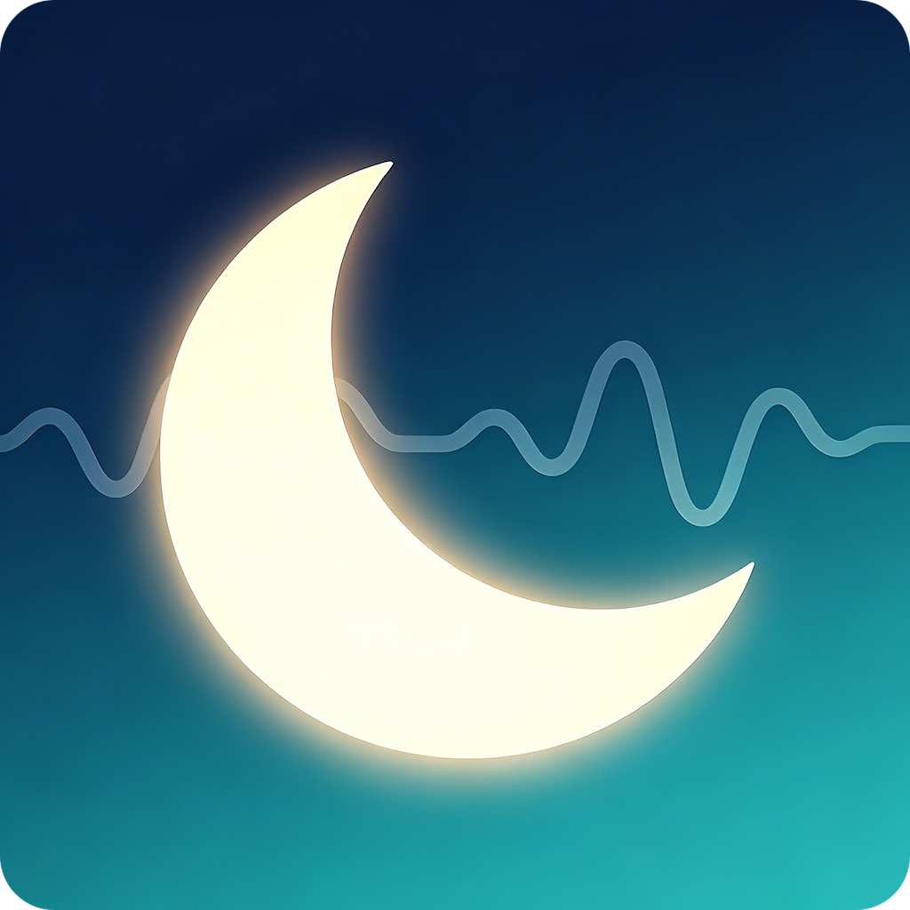
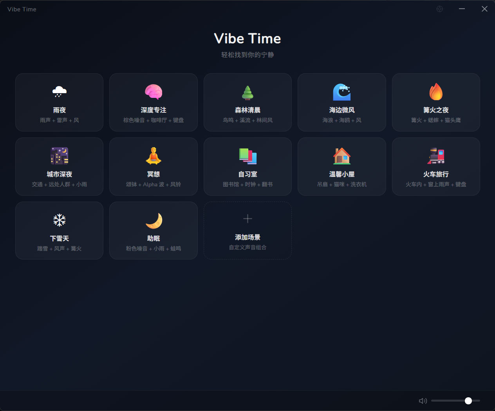
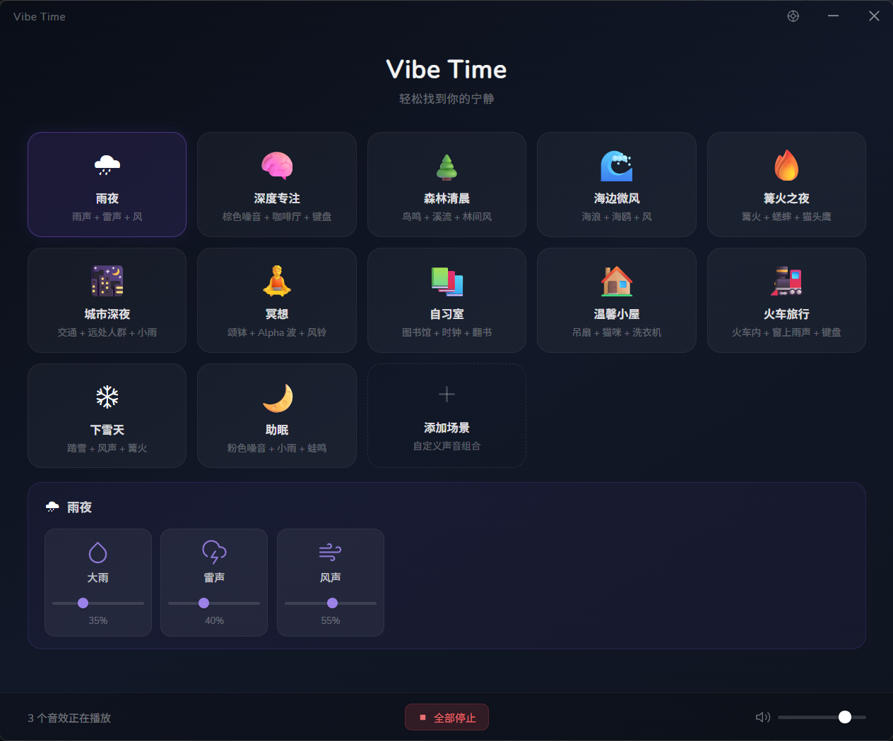
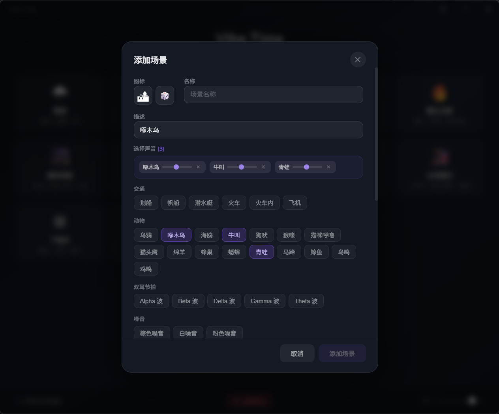
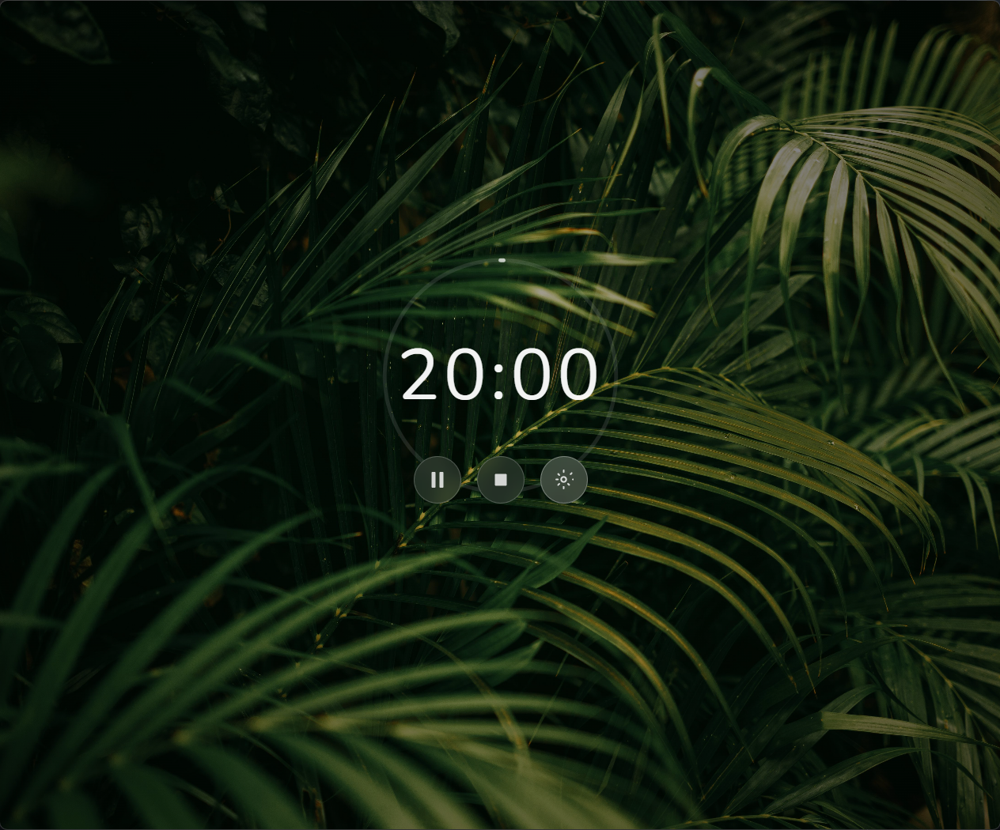

<p align="center">
  
</p>

<h1 align="center">Vibe Time</h1>

<p align="center">轻松找到你的宁静 — 一款桌面白噪音/环境音应用，帮助你专注、放松和入眠。</p>

<p align="center">
  <a href="https://github.com/limengwei/VibeTime/releases/tag/v2.0.0">
    
  </a>
</p>

## 截图

<p align="center">
  
  
  
  
</p>

## 功能特性

- **89 个高品质环境音** — 覆盖 9 大分类：动物、自然、雨声、噪音、场所、物品、交通、城市、双耳节拍
- **场景预设** — 内置「雨夜」「深度专注」「森林清晨」等多个一键场景，也支持自定义预设
- **专注模式** — 全屏沉浸体验，支持倒计时（5/10/20/30/60 分钟）和精美壁纸背景
- **独立音量控制** — 每个音效可单独调节音量，全局主音量控制
- **多音混合播放** — 同时播放多个音效，自由叠加创造属于你的声景
- **系统托盘** — 关闭窗口后最小化到系统托盘，后台继续播放

## 技术栈

| 层 | 技术 |
|---|---|
| UI 框架 | Go 1.27 + [nsgo](https://github.com/nsgo-dev/nsgo)（纯 Go 原生渲染） |
| 音频引擎 | nsgo audio.Player（多音轨循环混音） |
| 界面图标 | [Lucide](https://lucide.dev)（ISC，经 icons MCP 获取） |
| 资源打包 | go:embed（音效/壁纸全部内嵌，单文件约 135MB） |

## 项目结构

```
vibe-time/
├── main.go                         # 入口：nsgo 窗口、托盘、单实例
├── assets.go                       # go:embed 内嵌音效/壁纸/图标
├── nsgo.yaml                       # nsgo 工具配置（构建/图标）
├── assets/
│   ├── audio/                      # 音效资源（MP3/WAV，89 个）
│   ├── wallpapers/                 # 专注模式壁纸
│   └── appicon.png                 # 应用/托盘图标
└── internal/
    ├── catalog/                    # 音效目录、场景预设、配方码、持久化
    ├── audio/                      # 多音轨循环播放引擎
    └── ui/                         # nsgo 界面：场景/混音/编辑器/专注模式
```

## 开发

### 前置要求

- [Go](https://go.dev/dl/) 1.27+（GOTOOLCHAIN=auto 会自动切换）
- 无需 Node.js 与前端工具链

### 构建与测试

```bash
go build -trimpath -ldflags "-s -w" -o dist/vibe-time.exe .
go test ./...
```

带 exe/窗口图标的发布构建（读 `nsgo.yaml` 生成资源）：

```bash
go tool nsgo build
```

## 音效分类

| 分类 | 示例 |
|---|---|
| 🐾 动物 | 鸟鸣、猫呼噜、蟋蟀、鲸鱼、狼嚎… |
| 🌿 自然 | 篝火、河流、瀑布、海浪、丛林… |
| 🌧 雨声 | 大雨、小雨、帐篷雨声、雷声… |
| 🔊 噪音 | 白噪音、棕色噪音、粉色噪音 |
| 🏢 场所 | 咖啡厅、图书馆、机场、地铁… |
| 🔔 物品 | 时钟、打字机、颂钵、风铃… |
| 🚂 交通 | 飞机、火车、帆船、潜水艇… |
| 🏙 城市 | 繁忙街道、烟花、高速公路… |
| 🧠 双耳节拍 | Alpha、Beta、Delta、Theta、Gamma |

## 声明

- 声音文件来源：[Moodist](https://github.com/remvze/moodist)
- 背景图片来源：网络

## License

MIT
